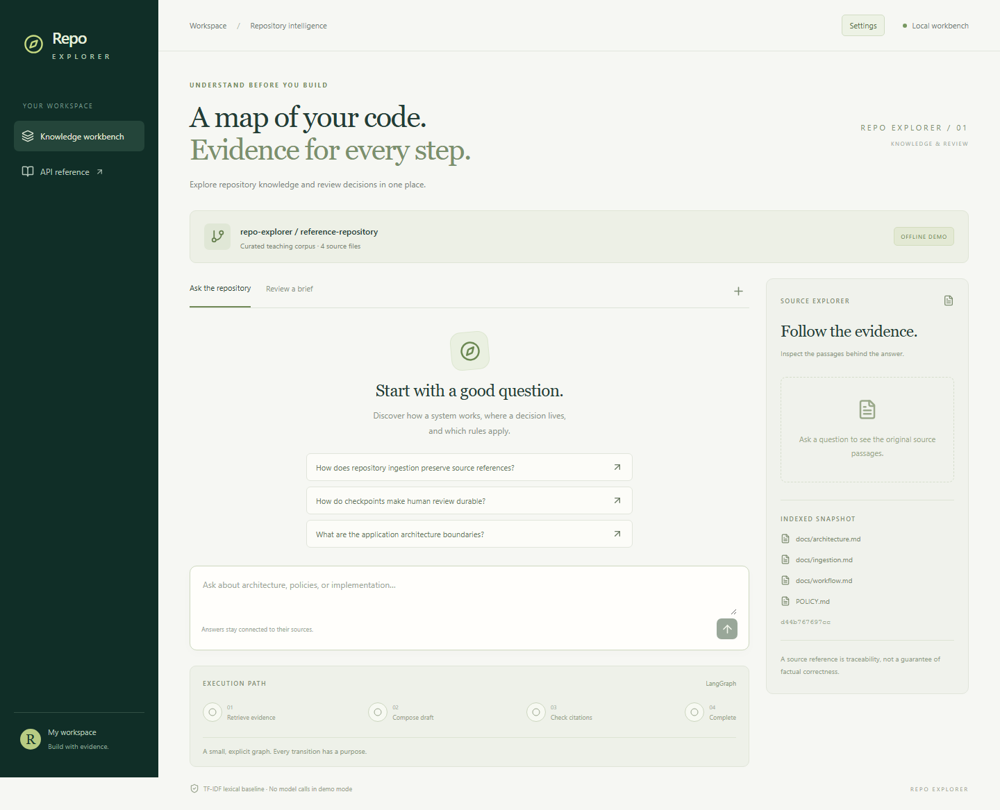

# Repo Explorer

Explore a local code repository with cited answers, focused code maps, and saved
review decisions. Repo Explorer brings **RAG, LangChain, and LangGraph** together
in a working AI engineering project.



## What you can do

- **Ask questions with sources.** Retrieve repository passages and inspect file paths,
  line ranges, and citations beside the answer.
- **Inspect code visually.** Explore a bounded map of files, Python classes, and
  functions, with links back to the supporting passages.
- **Follow and review a run.** Inspect workflow steps, revisit saved answers, and
  approve or reject review briefs using persistent LangGraph checkpoints.
- **Customize the pipeline.** Configure source selection, retrieval, context expansion,
  models, embeddings, and pluggable adapters.
- **Build your own frontend.** The FastAPI backend runs independently; the bundled
  React workbench is one client of its documented HTTP API.

## Try it locally

Requires **Python 3.12+** and, for the bundled frontend, **Node.js 22+**.
From the repository root on Windows / PowerShell:

```powershell
python -m venv .venv
.\.venv\Scripts\python.exe -m pip install -r requirements.lock
.\.venv\Scripts\python.exe -m pip install --no-deps -e .
npm ci --prefix frontend
.\scripts\start.ps1
```

Open [the workbench](http://127.0.0.1:5178). Stop it with `./scripts/stop.ps1`.
For macOS/Linux, backend-only startup, and workspace setup, see
[Getting started](docs/GETTING_STARTED.md).

The default demo uses an authored teaching repository, local TF-IDF retrieval,
and extractive answers. It makes no model calls. To use a model, follow
[live generation setup](docs/GETTING_STARTED.md#live-generation).

## Learn more

| Topic | Guide |
| --- | --- |
| Settings, providers, and custom adapters | [Configuration](docs/CONFIGURATION.md) |
| Backend endpoints and your own frontend | [HTTP API](docs/API.md) |
| Visual blocks and source relationships | [Evidence map](docs/EVIDENCE_MAP.md) · [Python source analysis](docs/SOURCE_ANALYSIS.md) |
| Retrieval and bounded context expansion | [Retrieval evaluation](docs/EVALUATION.md) · [Context expansion](docs/CONTEXT.md) |
| Live-model observations and limitations | [Live observations](docs/LIVE_OBSERVATIONS.md) |
| Architecture, current scope, and future work | [Scope and architecture](docs/SCOPE.md) |
| Development commands and Git hooks | [Development guide](docs/DEVELOPMENT.md) · [Contributing](CONTRIBUTING.md) |

The [five-part article series](docs/articles/README.md) explains AI engineering,
RAG, LangChain, and LangGraph through this project's code, diagrams, and screenshots.
The articles are editorial drafts. Browse the [documentation index](docs/README.md)
for all guides and evaluation studies.

## Current limits

**v0.1 is a single-user local prototype.** It reads one configured directory and
has no authentication; keep it on loopback. Python maps show lexical containment;
cross-file call graphs and frontend/backend contract discovery are deferred.
Citation checks validate references, while factual support still requires review.
The application records review decisions and leaves repository code unchanged.
See [scope and operating limits](docs/SCOPE.md) for details.

## License

[MIT](LICENSE). Third-party evaluation sources retain their included license notices.
