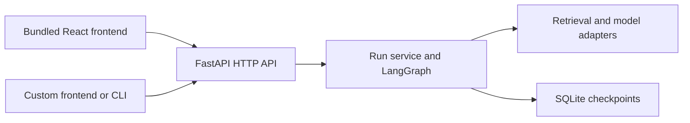

# Repo Explorer

A configurable repository knowledge and review workbench built around RAG,
LangChain, and LangGraph. Ask about indexed repository content, inspect cited
source passages and their containment map, and save a review brief for a decision.

The core goal is to demonstrate a useful, complete AI engineering workflow:
repository ingestion, retrieval, model integration, stateful orchestration,
evaluation, and an interface that makes the result inspectable. The project's
practical advantage over ordinary search and assistant use remains a hypothesis
to evaluate. Feature choices should follow evidence of a useful improvement.


## Current status

Repo Explorer 0.1.0 is a local prototype with a frozen feature scope. The screenshot
shows the offline demo. The available capabilities below form this release;
the future work column is deferred. Publication proceeds through GitLab checks,
then GitHub, then the accompanying blog series. See [release verification](docs/RELEASE.md).

| Area | Included in v0.1 | Deferred work |
| --- | --- | --- |
| Repository input | One configured local directory, text chunks, source paths, line ranges, and content hashes | Reproducible snapshots tied to repository revisions; explicit workspace mappings for related components |
| RAG and generation | TF-IDF with optional identifier tokenization, optional local learned embeddings, extractive demo answers, and observed Codex-backed explanations; configurable adapters | Broader answer-quality review and retrieval improvements justified by observed failures |
| Orchestration | Retrieve, optionally expand nearby source context, compose with an explicit answerability assessment, validate citations, then stop, finish, or pause for review; SQLite checkpoints | Question-driven follow-up retrieval for missing context and independent evidence-sufficiency checks |
| Interface | Questions, source excerpts, answer assessments, workflow steps, Settings, reloadable runs, and a bounded containment map with passage links | Broader investigation views with supported cross-file relationships |
| Code relationships | Optional Python definition metadata and explicit file/class/function containment, with partial spans and visible map limits | Cross-file and cross-language relationship resolution |
| Evaluation | Snapshot-pinned lexical/learned comparisons on authored examples and Cachetools; HTTPX evidence-map inspection including failures; saved evidence, draft/final reports and assistant source inspection; demo and Codex-backed browser journeys | Independent annotation review, broader repository evaluation, and an ordinary search/assistant comparison |
| Articles | Five written drafts explaining AI engineering, RAG, LangChain, and LangGraph through the prototype, with diagrams and actual offline/live screenshots | Final editorial review, additions for remaining release features, and blog publication |

The [live observations](docs/LIVE_OBSERVATIONS.md) demonstrate Codex-backed generation
on the teaching fixtures, including a browser journey through partial answers,
context expansion, and insufficient evidence. A separate
[retrieval comparison](docs/SEMANTIC_RETRIEVAL.md) examines local learned embeddings
against TF-IDF. The [HTTPX inspection](docs/MAP_EVALUATION.md) checks containment
against source-card metadata and full-source reading. An initial generation
failure remains recorded; a retry with the same evidence completed with a partial
answer and the same missing call path. Other chat providers and remote embeddings still need separate
verification. Citation-ID validation checks reference
structure; it does not establish that every
claim is supported by the cited passage. An approved review records acceptance of
a brief, not approval of an automatically validated code change.

## Future investigation workflow

1. **Configure a workspace.** Select repository checkouts, engineering rules,
   providers, and models. Record the revisions being investigated.
2. **Start an investigation.** Ask how a workflow behaves, or supply a diff and ask
   which components warrant inspection.
3. **Gather evidence.** Retrieve code and documentation with source locations and
   revision information preserved.
4. **Resolve missing context.** Follow a bounded investigation workflow that can
   retrieve additional evidence, finish, or state that the evidence is insufficient.
5. **Inspect the explanation.** Read sources beside the answer and expand a small
   map of the relevant components. Each relationship discloses its basis.
6. **Save and review.** Preserve the explanation, evidence, execution trace, and any
   human review decision so the investigation can be revisited.

Change-impact output is an evidence-backed assessment for a developer to review.
It must distinguish supported relationships from possible effects and unresolved
dependencies.

## Engineering responsibilities

| Layer | Responsibility |
| --- | --- |
| RAG | Find and assemble relevant repository evidence while preserving provenance. Evaluate retrieval separately from answer generation. |
| LangChain | Integrate replaceable models, embeddings, retrieval components, and structured responses. |
| LangGraph | Coordinate investigation state, conditional steps, bounded retries, checkpoints, and human review where a decision is needed. |
| Source analysis | Supply supported code relationships and explicit contracts through adapters. Its coverage is separate from the model's ability to explain text. |
| React | Present configuration, questions, source evidence, workflow progress, and focused visual exploration. |
| Evaluation and observability | Assess evidence relevance, supported explanations, missing-context handling, execution behavior, latency, and cost. |

Providers, repository selection, retrieval settings, and adapters should remain
configurable. Reuse established analysis tools and protocols where appropriate;
language support and framework-specific behavior must be documented. LangChain
and LangGraph do not supply a universal source-code analysis engine.

## Backend core and optional frontend

Repo Explorer's backend runs independently. The repository includes a React
workbench as a ready-to-use frontend, but users can build their own interface,
CLI, or integration against the same JSON HTTP API. React and Node.js are not
required to run the backend.



The backend owns repository ingestion, retrieval, model calls, citation validation,
workflow transitions, review decisions, and persistence. Clients submit questions,
display answers and source evidence, and send explicit review decisions. Provider
credentials and orchestration stay on the server. Replacing the frontend does not
require rebuilding the RAG pipeline or duplicating its state machine.

Start with [the backend API guide](docs/API.md) for the endpoint reference,
request examples, run lifecycle, and a framework-independent JavaScript client.
It covers both a same-origin proxy and configurable CORS for a separate frontend.
For backend extension points, see [configuration and plugin contracts](docs/CONFIGURATION.md).

## v0.1 scope and deliverables

This release reads one configured local source directory and runs a bounded RAG
workflow. The optional Python analyzer supplies lexical containment. Calls across
files, frontend/backend contract discovery, change-impact analysis, automatic
follow-up retrieval, additional language analyzers, and large-repository scaling
are deferred. Automatic repository synchronization, security scanning, code
modification, deployment, and multi-user hosting are also outside v0.1.
See [Boundaries](#boundaries) for the operational limits.

The release contains:

- An independently runnable backend, configurable adapters, persisted settings,
  and a documented HTTP API.
- An optional React workbench with source inspection, answer coverage, containment
  maps, saved runs, and durable review decisions.
- Snapshot-backed evaluation tools, authored examples, and pinned public-package
  studies with their observed failures and limits.
- Five article drafts with diagrams and actual screenshots, plus an HTML preview.
- GitLab CI for backend checks, the frontend build, offline browser journeys, and
  article rendering. A passing remote pipeline is required before GitHub publication.

Start with the authored examples in the quickstart. The
[HTTPX study](docs/MAP_EVALUATION.md) demonstrates a public-source investigation,
including the missing cross-file evidence. Live studies are opt-in and excluded
from CI. Independent human answer-quality review remains pending.

## Accompanying articles

The article drafts explain the delivered prototype and identify deferred work.
Final blog publication follows GitLab CI, review, and GitHub publication.

| Article | What it should explain and demonstrate |
| --- | --- |
| 1. AI engineering and architecture | What an AI engineer does, why this investigation task is worth evaluating, and how RAG, LangChain, LangGraph, and the API fit together. |
| 2. Repository RAG | Ingestion, chunking, retrieval, provenance, and what observed retrieval failures teach us. |
| 3. LangGraph orchestration | State, conditional retrieval, stopping rules, recovery, and the purpose of human review. |
| 4. Evidence-centered interface | How sources, workflow traces, and focused visual relationships help readers inspect an explanation without overwhelming them. |
| 5. Evaluation and lessons | The real case study, baseline comparison, meaningful quality/cost/latency findings, limitations, and justified next steps. |

Readers should be able to follow a claim from the interface through the AI workflow
to the supporting code. Screenshots must come from the working application;
diagrams should explain one concern at a time. The articles should explain the
principles of RAG, LangChain, and LangGraph through their actual use in Repo Explorer.

## Publication plan

Repo Explorer is an independent project. Once the agreed application, evaluation,
and article deliverables are complete, publish this repository to the owner's new
GitHub account. The account and repository destination will be supplied at that
stage. GitHub publication is a final delivery step; this local prototype has not
been published there.

## Start locally

The backend requires Python 3.12+. The bundled frontend additionally requires
Node.js 22+. Run commands from this repository root.

```powershell
python -m venv .venv
.\.venv\Scripts\python.exe -m pip install -r requirements.lock
.\.venv\Scripts\python.exe -m pip install --no-deps -e .
```

**Backend only:** no frontend installation or build is needed.

```powershell
.\.venv\Scripts\python.exe -m uvicorn repo_explorer.api:app --host 127.0.0.1 --port 8018 --workers 1
```

The API is at `http://127.0.0.1:8018/api`, with interactive documentation at
[`/docs`](http://127.0.0.1:8018/docs) and schemas at
[`/openapi.json`](http://127.0.0.1:8018/openapi.json). Use one backend worker for
the current local runtime. See [the API guide](docs/API.md) to make your first request.

**Backend plus bundled frontend:** instead of the backend-only command, install
the frontend dependencies and start both services:

```powershell
cd frontend
npm ci
cd ..
.\scripts\start.ps1
```

The launcher opens no external windows. Visit [the workbench](http://127.0.0.1:5178).
Stop the launched services with
`./scripts/stop.ps1`. On macOS/Linux, activate the virtual environment and run
`python -m uvicorn repo_explorer.api:app --host 127.0.0.1 --port 8018 --workers 1`
in one terminal; optionally run `npm run dev` from `frontend` in another.

The bundled frontend sends relative `/api` requests through Vite's development
proxy. For a custom frontend, choose a proxy or configure allowed browser origins
with `REPO_EXPLORER_CORS_ORIGINS`; see [client connection options](docs/API.md#connect-a-custom-frontend).

The default corpus is a public-safe teaching fixture. Demo mode runs real
LangChain retrieval and a real LangGraph state machine, using local TF-IDF vectors
and an extractive response generator. It makes no model calls. **It is not a
demonstration of learned semantic retrieval or live LLM answer quality.**

## Configure your workspace

Open **Settings** in the workbench to change workspace labels, suggested questions,
repository directory, file selection, chunking, retrieval limits, chat and embedding
providers, models, endpoints, and installed adapters. Apply validates the configuration,
rebuilds retrieval, and saves `repo-explorer.json` before switching the active workspace.
Existing review evidence remains available. Invalid changes leave the active setup intact.

Defaults can also be supplied through `.env` or `REPO_EXPLORER_` environment variables;
saved JSON settings take precedence. Credentials remain in server environment variables.
See [configuration and plugin contracts](docs/CONFIGURATION.md) for every setting,
optional providers, custom adapters, and non-secret plugin options.
Local ports are configurable: `./scripts/start.ps1 -ApiPort 8020 -WebPort 5180`.

Machine-specific values belong in the ignored `.env`, including the optional
`REPO_EXPLORER_CODEX_PROXY_URL`. Commit only placeholders in `.env.example`.
An enabled Windows proxy does not automatically configure the CLI's network route;
see [Codex proxy setup](docs/CODEX.md#networks-that-require-a-proxy). Users without
that requirement can leave the proxy setting unset.

With TF-IDF, **Settings → Retrieval → TF-IDF tokenization → code_identifiers**
enables matching across words inside `snake_case`, `camelCase`, and `PascalCase`
names. The default remains `standard`. This is a lexical option, not symbol
resolution or learned semantic retrieval. The [evaluation guide](docs/EVALUATION.md)
includes a reproducible example and shows where the option still fails.

**Settings → Evidence context → line_window** enables an optional LangGraph step
that adds neighboring lines to retrieved passages. Users control the line window
and shared extra-character budget. The trace records original/expanded ranges and
skipped windows, and reads from the indexed snapshot. It cannot discover a missing
file or establish that the question is answerable. See [bounded context expansion](docs/CONTEXT.md).

Live responses report **complete**, **partial**, or **insufficient evidence**, with
missing information shown beside the answer. These are model assessments of the
supplied context, not factuality guarantees. Workflow status is separate: approving
a partial brief preserves its limitations. Insufficient responses stop before review;
invalid citations receive a distinct rejection. Demo and older saved responses show
**not assessed**. Custom clients can use the same [answerability fields](docs/API.md#answer-coverage-is-separate-from-approval).

Optional **Source analysis → python_ast** identifies the class and function names
behind Python passages, including excerpts that omit the class header. It preserves
retrieval ranking, records partial definition coverage, and reports unsupported or
unparseable files explicitly. The analyzer and per-passage limit are configurable;
the API exposes the same metadata to custom frontends. See
[source identity and its limits](docs/SOURCE_ANALYSIS.md). This is syntax provenance,
not a runtime call graph.

The **Evidence map** below the workflow trace groups the answer's cited files and
definitions using those containment relationships. Select a block to see its
supporting passages, then open one in the source explorer. **Maximum map blocks**
controls the saved view's size; missing analysis and omissions remain visible.
The backend saves the same nodes and edges for any API client. See
[the evidence map guide](docs/EVIDENCE_MAP.md) for scope, configuration, and the
actual browser example.

## Live generation

Copy `.env.example` to `.env`, set `REPO_EXPLORER_MODE=live`, `REPO_EXPLORER_MODEL` to a supported
model, and `OPENAI_API_KEY` in the server environment. The adapter uses
`langchain-openai`; the endpoint must support its structured-output contract.
An optional `REPO_EXPLORER_BASE_URL` supports compatible endpoints, but compatibility is
provider-specific. No API key belongs in browser code or article assets.

Set `REPO_EXPLORER_EMBEDDING_PROVIDER=openai` and `REPO_EXPLORER_EMBEDDING_MODEL` to enable learned
semantic embeddings. With the default `tfidf` provider, live generation still
uses the lexical retrieval baseline. Configuring remote
embeddings sends indexed text to that provider; configuring live generation sends
retrieved passages and policy to the model. Use a curated corpus you intend to send.
Use Apply settings to rebuild after corpus changes. File/environment edits require
a restart. Recalibrate `REPO_EXPLORER_MINIMUM_SCORE`
when changing embedding models; cosine scores are not confidence probabilities.

For local learned embeddings, install `.[fastembed]`, select `fastembed` as the
embedding provider, and choose a supported embedding model in Settings. The first
use downloads model files; embedding runs locally afterward. Leave the embedding
endpoint and credential fields empty. Cache location, CPU threads, and cached-only
operation are [server settings](docs/CONFIGURATION.md#local-learned-embeddings-with-fastembed).
This works independently of the chat provider, including Codex CLI generation.

The hosted API adapters still need their own credentials and live verification.
An optional **Codex CLI adapter** can
reuse the server user's CLI sign-in: select `codex` as the chat provider and choose
an accessible model. See [Codex setup and evaluation](docs/CODEX.md). A local Codex
run completed the pipeline and returned cited explanations of both public cache
examples after configuring the backend's proxy. This confirms that integration on
that teaching question; it is not a general answer-quality result. The subsequent
[live comparisons](docs/LIVE_OBSERVATIONS.md) show how incomplete context, missing
facts, and paraphrases affect the pipeline. Provider failures remain explicit.

## Evaluate retrieval locally

The offline runner compares standard TF-IDF, identifier-aware TF-IDF, and a
keyword-overlap baseline on the same verified source snapshot. A fourth method
adds bounded context to identifier matches and records the additional context size.
The runner records retrieved passages,
missing reference evidence, context returned for unanswerable questions, and
timings. It makes no model calls and does not grade generated answers.

```powershell
.\.venv\Scripts\python.exe -m repo_explorer.evaluation --suite evaluations/reference.json --repository examples/repository --output .repo-explorer/evaluations/reference
```

Choose a new output directory for each experiment. The output includes source
files, annotations, effective settings, and JSON/Markdown reports for replay.
See [the evaluation guide](docs/EVALUATION.md) for Git snapshots, scoring rules,
configuration, and limitations. The public teaching suite is deliberately small;
private repository cases and their source copies stay in local ignored artifacts.

## Evaluate live explanations

The live runner reuses the backend's retrieval, LangChain generator, and LangGraph
workflow. It records the model's parsed draft before citation validation, the final
answer, exact context, coverage gaps, and elapsed timings. Human source-support
judgments remain pending until reviewed; valid citation IDs are not a quality score.

Start with a preflight that makes no provider calls:

```powershell
.\.venv\Scripts\python.exe -m repo_explorer.evaluation.live --suite evaluations/identifiers.json --repository examples/identifier-repository --config evaluations/live.example.json --output .repo-explorer/evaluations/live-preflight
```

The example reports the missing model configuration. Copy it to an ignored local
file, choose providers/models and server credentials, then use `--execute` with a
new output directory. See [live evaluation](docs/LIVE_EVALUATION.md) for configuration,
reviewing claims, comparing learned retrieval with TF-IDF, and interpreting failures.
The [recorded live comparisons](docs/LIVE_OBSERVATIONS.md) include assistant source
inspection. Independent human review and general answer-quality claims remain pending.
The [lexical versus learned retrieval experiment](docs/SEMANTIC_RETRIEVAL.md) also
includes a pinned public Cachetools package snapshot, model-file identities, and
reproducible configurations. It examines evidence and explanations, not test totals.
The [HTTPX map inspection](docs/MAP_EVALUATION.md) adds a second pinned public
package, preserves the failed cross-file question, and records follow-ups separately.
A retry completed with the same partial context. Increasing the existing passage
limit recovered API entry points but still missed the synchronous client path;
the default retrieval settings remain unchanged.

## Layout

```text
backend/src/repo_explorer/    configuration, retrieval, generation, graph, service, API
backend/tests/       API, behavior and restart checks
evaluations/         public, source-backed retrieval evaluation suite
frontend/src/        typed API client, workbench, evidence and trace components
frontend/tests/      browser journeys and reproducible article captures
examples/repository/ public-safe repository knowledge fixture
examples/identifier-repository/ small authored code fixture for tokenization comparisons
examples/context-repository/ authored function split across retrieval chunks
docs/API.md          backend contract, custom clients and connection options
docs/articles/       five-part technical series, captions and image assets
docs/decisions/      framework choice and boundaries
scripts/             local startup, shutdown and documentation tooling
```

Start reading at [the series index](docs/articles/README.md). Build the self-contained
HTML article preview with `node frontend/scripts/build-docs.mjs`; open
`docs/site/index.html`. Article content and captions describe behavior, not test totals.

## Agent guidance and Git hooks

[`AGENTS.md`](AGENTS.md) gives coding agents the project's working rules:
justify substantial features with a concrete need, preserve the backend/API boundary,
keep integrations configurable, verify relevant behavior, and distinguish observed
results from planned capabilities. [`CONTRIBUTING.md`](CONTRIBUTING.md) defines the
shared naming and architectural conventions. Instructions guide judgment; executable
checks catch specific mechanical mistakes.

The repository uses [pre-commit](https://pre-commit.com/) with the official
[Ruff hooks](https://github.com/astral-sh/ruff-pre-commit). Install the optional hook
tools and enable them once per clone, from the project root:

```powershell
.\.venv\Scripts\python.exe -m pip install -r requirements-hooks.lock
.\.venv\Scripts\python.exe -m pre_commit install
```

On macOS/Linux, use `.venv/bin/python` in the same commands. Hook definitions and
tool versions are in [`.pre-commit-config.yaml`](.pre-commit-config.yaml); the installed
Git hook and its interpreter path are local. Reinstall after moving or recreating
the virtual environment. The first Ruff run downloads its pinned environment;
subsequent checks reuse the cache. Network proxy settings for installing tools remain
local environment settings, separate from the application's Codex proxy option.

| Commit check | Scope and behavior |
| --- | --- |
| Local-file guard | Rejects staged `.env` and `.env.*` except `.env.example`, `repo-explorer.json`, and files under `.repo-explorer/`, including forced additions. |
| Whitespace and conflict markers | Checks the staged Git diff. It does not rewrite files. |
| Python lint and formatting | Runs Ruff on staged Python files under `backend/`, in check-only mode. Teaching fixtures and article code blocks are excluded. |

Normal commits check staged content, including partially staged files. Fix failures,
inspect the diff, and stage the intended correction before retrying. The local-file
guard checks paths, not arbitrary secrets or copied private source inside other files;
review the staged diff before sharing. Hooks run locally and are not a server-enforced
policy or proof of answer quality.

Run the checks explicitly when useful:

```powershell
.\.venv\Scripts\python.exe -m pre_commit run
.\.venv\Scripts\python.exe -m pre_commit run --all-files
```

The first command checks staged changes. The second checks all tracked files for
the file-based hooks; the whitespace check still examines only the staged diff.
New untracked files are checked after staging or by passing `--files` explicitly.
To remove this clone's installed hook, run `python -m pre_commit uninstall` using
the same virtual-environment interpreter.

There are no Codex lifecycle hooks enabled by this setup. The optional Codex generation
adapter also keeps hooks disabled so development automation cannot alter its evidence
input. Git hooks do not run E2E tests, contact models, publish, or deploy. They work
independently of the AI assistant used to edit the repository.

## Developer checks

Choose checks based on the change. Backend behavior needs relevant pytest coverage;
frontend changes need type checking and a build, with browser journeys for affected
user flows. Pipeline changes may need an explicit source-backed evaluation. Article
changes need link checks and a rebuilt, rendered preview. Hook checks complement
these steps; they do not replace them.

```powershell
.\.venv\Scripts\python.exe -m pytest
.\.venv\Scripts\python.exe -m ruff check backend
.\.venv\Scripts\python.exe -m ruff format --check backend
cd frontend
npm run build
npx playwright install chromium
npm run test:e2e
```

Stop the local preview first: browser checks own ports 8018 and 5178 and use their
own checkpoint directory. Screenshots are generated into `docs/articles/assets`.

### Verify the live browser workflow

Live browser verification is a separate, opt-in command. It makes real model calls
and can consume provider usage. Copy `evaluations/codex.example.json` to an ignored
local file and choose your accessible model, or supply another configured chat
adapter using the same workspace fields. Then, from the repository root:

```powershell
$env:REPO_EXPLORER_LIVE_CONFIG = (Resolve-Path .repo-explorer/codex-eval.json).Path
cd frontend
npm run test:e2e:live
```

Provide credentials, an optional native Codex executable, and any required proxy
in the test process environment. This command launches its backend from `frontend`,
so it does not load the repository-root `.env`. Only shareable generation choices
belong in the JSON; the proxy value stays private.

The suite owns separate ports (API 8020 and web 5180 by default), configurable with
`REPO_EXPLORER_LIVE_API_PORT` and `REPO_EXPLORER_LIVE_WEB_PORT`. It creates a separate
ignored runtime under `.repo-explorer/live-e2e/` and does not use the preview's index,
settings, or checkpoints. It fixes retrieval to TF-IDF and the authored public context
fixture, taking chat-provider settings from the selected config. No private repository
is used. Ordinary E2E runs and commit hooks do not invoke this suite.

The browser asks for a function explanation with truncated evidence, approves a
partial brief, expands the source context for a complete explanation, and asks an
unanswerable deployment question. It checks source inspection, saved-run reload,
missing-information display, and the absence of approval for insufficient evidence.
It saves actual live screenshots and attaches the returned JSON for source review.
Assertions check the requested classifications; provider disagreement is a result
to inspect, not something the suite rewrites or automatically retries. The browser
checks do not independently grade every generated claim.

## Boundaries

This release answers questions and records review decisions. It does not modify
repositories, run arbitrary commands, create merge requests, or deploy software.
It is a single-user loopback application with a bounded in-memory index and local
SQLite persistence. It has no authentication or document-level access control.
It must not be exposed as a public service without adding those boundaries.

Citation validation checks source IDs, not whether every claim follows from a
source. The retrieval threshold is a starting heuristic. Resume behavior is designed
for restarts of the same graph version; graph-schema migrations are not implemented.
GitLab CI runs offline verification through [`.gitlab-ci.yml`](.gitlab-ci.yml).
It makes no model calls and performs no publishing or deployment.
