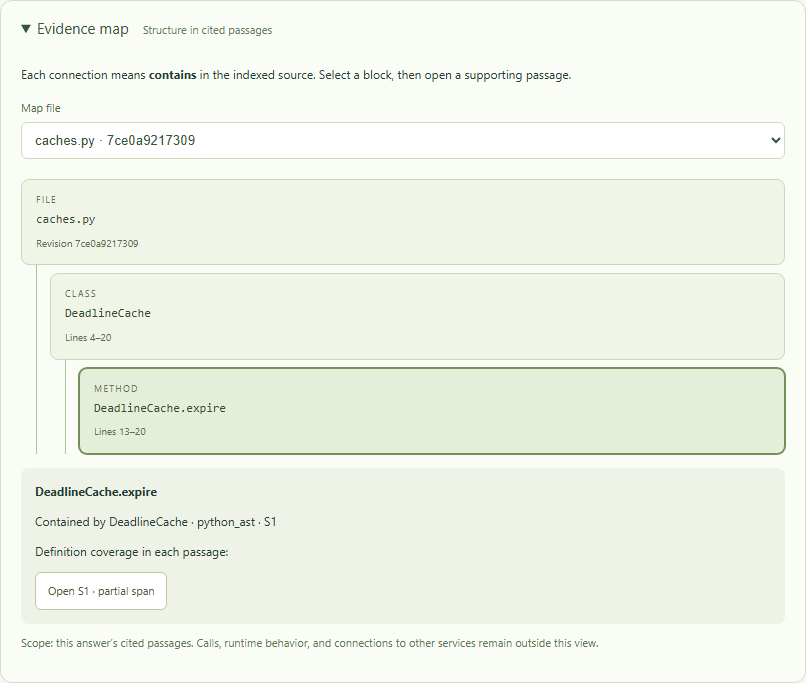

# A focused map of cited evidence

The evidence map shows the file, class, and function definitions represented in
an answer's cited passages. It answers a bounded question: which definition is
this excerpt from, and where is it declared? Selecting a block exposes its source
references; opening one expands and focuses the original passage.



The capture uses the authored `examples/symbol-repository` in offline demo mode.
The question “deadline has arrived” returns part of `DeadlineCache.expire`. The
class header is outside the excerpt, but the indexed Python syntax establishes
the containment. The selected method still shows partial definition coverage.

## Configure and use it

1. Select **Settings → Evidence context → Source analysis → python_ast** and Apply.
2. Ask a question about an indexed Python source. Expand **Evidence map** below
   the workflow trace if it is collapsed.
3. Choose a file, select a block, then use **Open S1** or another passage button.
   Native buttons support keyboard focus and activation.

`source_symbol_limit` bounds definitions attached to each passage, defaulting to
8. `evidence_map_node_limit` bounds the combined map, defaulting to 40 with a range
of 2–200. The map includes file blocks in that limit. Both settings are public
workspace configuration and available through the API. Environment defaults are:

```dotenv
REPO_EXPLORER_SOURCE_ANALYZER=python_ast
REPO_EXPLORER_SOURCE_SYMBOL_LIMIT=8
REPO_EXPLORER_EVIDENCE_MAP_NODE_LIMIT=40
```

Limits apply to new runs. An existing run retains its saved map. A small limit can
leave a method out of the view; the omitted-block message describes that reduction.
The original cited passages remain inspectable in the source explorer.

## How the backend establishes containment

The source analyzer parses the full indexed file and records the enclosing
definition's ID while traversing the syntax tree. It attaches explicit
`relationships` to each analyzed passage. Every relationship has `kind=contains`,
a `child_id`, and a `parent_id`. A null parent denotes the indexed file's module
scope. An empty relationship list means analysis supplied no overlapping
definitions. A null relationship list means containment metadata is unavailable,
including results from older analyzers.

The IDs distinguish repeated declarations even when their qualified names match.
The projection uses these IDs and the explicit relationships. It never constructs
edges by splitting names at dots or comparing line ranges.

After citation validation, the LangGraph validation node builds the map from only
the passages cited by the accepted response. It saves the result in the same
checkpoint as the answer. Invalid citations produce no map. A response reporting
insufficient evidence can have a map when it cites passages; those passages may
help explain why the requested fact is missing.

This step makes no model call and reads no current checkout files. Retrieval,
ranking, and excerpt text are unchanged. A review decision preserves the map;
applying new settings or editing the repository cannot replace an earlier run's
evidence. Older checkpoints without a map return `null`.

## API contract for custom frontends

The create, read, and review endpoints expose the same optional `evidence_map`
field on `RunView`:

| Field | Meaning |
| --- | --- |
| `scope` | `cited_passages`; the view covers the answer's cited evidence |
| `nodes` | File and definition blocks with IDs, labels, kind, path, revision, definition lines, and supporting source references |
| `edges` | Explicit `contains` relationships with parent/child node IDs, analyzer method, and supporting source IDs |
| `issues` | Per-passage gaps such as unavailable analysis, unsupported language, an analyzer limit, or an unresolved relationship |
| `node_limit` | The limit used when this run was created |
| `omitted_nodes` | Unique blocks removed by the map limit, separate from per-passage analyzer omissions |

Each node's `sources` list records a `source_id` and coverage for that individual
passage. A definition can have both partial and full spans in different passages;
the map preserves each assessment. File entries have null coverage. Definition
lines describe the indexed declaration; inspect the citation for excerpt lines.

Map IDs are opaque and include the file revision and analyzer identity where
applicable. Matching definitions from the same analysis and snapshot are merged.
Different files or revisions remain separate. Only edges with both endpoints in
the returned map are included. Missing endpoints, conflicting parents, and cycles
from an analyzer produce visible issues. Unlinked definitions stay unlinked.

Custom language analyzers can supply the same containment contract through the
existing `analyzers` registry. A client can render the returned nodes and edges
using its own UI framework. No React-specific coordinates or state appear in the API.

## Rendering choice and limits

The bundled frontend presents one file at a time using nested blocks, native
buttons, a select control, and an HTML disclosure element. The current relation
is hierarchical, so the browser can lay out this view directly. The
[HTML details element](https://developer.mozilla.org/en-US/docs/Web/HTML/Reference/Elements/details)
provides the outer collapse/expand control. [React Flow](https://reactflow.dev/learn)
offers a node-and-edge canvas for more general interactive graphs; it remains a
possible renderer if supported cross-file relationships justify that interaction.

The map currently exposes lexical containment in supported source files. It does
not resolve call targets, imports, inheritance, dynamic dispatch, security findings,
or frontend/backend API connections. Selecting a small set of evidence helps keep
the view readable, but it leaves unreturned code outside the map. No completeness
or large-repository performance claim follows from this example.

The screenshot and browser journey demonstrate selecting a definition and reading
its source, including keyboard and mobile use. Whether this reduces investigation
time compared with an IDE remains an evaluation question.

The [HTTPX inspection](MAP_EVALUATION.md) checks a second public package against
ordinary source inspection and existing source-card metadata. It records a correct
containment example, incomplete cross-file retrieval, a generation error, and
separate follow-ups. An expansion range bug discovered there was corrected and
the repeated live run retained class identity with a full method span. The study
provides no human productivity comparison.
