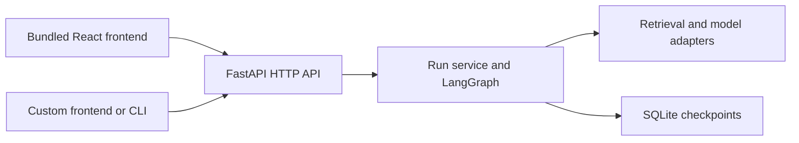

# Scope and architecture

[Project overview](../README.md) · [Documentation index](README.md)

The v0.1 capabilities, operating limits, and deferred investigation workflow.

## Current status

Repo Explorer 0.1.0 is a local prototype with a frozen feature scope. The [README screenshot](../README.md)
shows the offline demo. The available capabilities below form this release;
the future work column is deferred. Publication proceeds through GitLab checks,
then GitHub, then the accompanying blog series. See [release verification](../docs/RELEASE.md).

| Area | Included in v0.1 | Deferred work |
| --- | --- | --- |
| Repository input | One configured local directory, text chunks, source paths, line ranges, and content hashes | Reproducible snapshots tied to repository revisions; explicit workspace mappings for related components |
| RAG and generation | TF-IDF with optional identifier tokenization, optional local learned embeddings, extractive demo answers, and observed Codex-backed explanations; configurable adapters | Broader answer-quality review and retrieval improvements justified by observed failures |
| Orchestration | Retrieve, optionally expand nearby source context, compose with an explicit answerability assessment, validate citations, then stop, finish, or pause for review; SQLite checkpoints | Question-driven follow-up retrieval for missing context and independent evidence-sufficiency checks |
| Interface | Questions, source excerpts, answer assessments, workflow steps, Settings, reloadable runs, and a bounded containment map with passage links | Broader investigation views with supported cross-file relationships |
| Code relationships | Optional Python definition metadata and explicit file/class/function containment, with partial spans and visible map limits | Cross-file and cross-language relationship resolution |
| Evaluation | Snapshot-pinned lexical/learned comparisons on authored examples and Cachetools; HTTPX evidence-map inspection including failures; saved evidence, draft/final reports and assistant source inspection; demo and Codex-backed browser journeys | Independent annotation review, broader repository evaluation, and an ordinary search/assistant comparison |
| Articles | Five written drafts explaining AI engineering, RAG, LangChain, and LangGraph through the prototype, with diagrams and actual offline/live screenshots | Final editorial review, additions for remaining release features, and blog publication |

The [live observations](../docs/LIVE_OBSERVATIONS.md) demonstrate Codex-backed generation
on the teaching fixtures, including a browser journey through partial answers,
context expansion, and insufficient evidence. A separate
[retrieval comparison](../docs/SEMANTIC_RETRIEVAL.md) examines local learned embeddings
against TF-IDF. The [HTTPX inspection](../docs/MAP_EVALUATION.md) checks containment
against source-card metadata and full-source reading. An initial generation
failure remains recorded; a retry with the same evidence completed with a partial
answer and the same missing call path. Other chat providers and remote embeddings still need separate
verification. Citation-ID validation checks reference
structure; it does not establish that every
claim is supported by the cited passage. An approved review records acceptance of
a brief, not approval of an automatically validated code change.

## Backend core and optional frontend

Repo Explorer's backend runs independently. The repository includes a React
workbench as a ready-to-use frontend, but users can build their own interface,
CLI, or integration against the same JSON HTTP API. React and Node.js are not
required to run the backend.

The backend owns repository ingestion, retrieval, model calls, citation validation,
workflow transitions, review decisions, and persistence. Clients submit questions,
display answers and source evidence, and send explicit review decisions. Provider
credentials and orchestration stay on the server. Replacing the frontend does not
require rebuilding the RAG pipeline or duplicating its state machine.

Start with [the backend API guide](../docs/API.md) for the endpoint reference,
request examples, run lifecycle, and a framework-independent JavaScript client.
It covers both a same-origin proxy and configurable CORS for a separate frontend.
For backend extension points, see [configuration and plugin contracts](../docs/CONFIGURATION.md).

## v0.1 scope and deliverables

This release reads one configured local source directory and runs a bounded RAG
workflow. The optional Python analyzer supplies lexical containment. Calls across
files, frontend/backend contract discovery, change-impact analysis, automatic
follow-up retrieval, additional language analyzers, and large-repository scaling
are deferred. Automatic repository synchronization, security scanning, code
modification, deployment, and multi-user hosting are also outside v0.1.
See [Boundaries](#boundaries) for the operational limits.

The release contains:

- An independently runnable backend, configurable adapters, persisted settings,
  and a documented HTTP API.
- An optional React workbench with source inspection, answer coverage, containment
  maps, saved runs, and durable review decisions.
- Snapshot-backed evaluation tools, authored examples, and pinned public-package
  studies with their observed failures and limits.
- Five article drafts with diagrams and actual screenshots, plus an HTML preview.
- GitLab CI for backend checks, the frontend build, offline browser journeys, and
  article rendering. A passing remote pipeline is required before GitHub publication.

Start with the authored examples in the quickstart. The
[HTTPX study](../docs/MAP_EVALUATION.md) demonstrates a public-source investigation,
including the missing cross-file evidence. Live studies are opt-in and excluded
from CI. Independent human answer-quality review remains pending.

## Engineering responsibilities

| Layer | Responsibility |
| --- | --- |
| RAG | Find and assemble relevant repository evidence while preserving provenance. Evaluate retrieval separately from answer generation. |
| LangChain | Integrate replaceable models, embeddings, retrieval components, and structured responses. |
| LangGraph | Coordinate investigation state, conditional steps, bounded retries, checkpoints, and human review where a decision is needed. |
| Source analysis | Supply supported code relationships and explicit contracts through adapters. Its coverage is separate from the model's ability to explain text. |
| React | Present configuration, questions, source evidence, workflow progress, and focused visual exploration. |
| Evaluation and observability | Assess evidence relevance, supported explanations, missing-context handling, execution behavior, latency, and cost. |

Providers, repository selection, retrieval settings, and adapters should remain
configurable. Reuse established analysis tools and protocols where appropriate;
language support and framework-specific behavior must be documented. LangChain
and LangGraph do not supply a universal source-code analysis engine.

## Future investigation workflow

1. **Configure a workspace.** Select repository checkouts, engineering rules,
   providers, and models. Record the revisions being investigated.
2. **Start an investigation.** Ask how a workflow behaves, or supply a diff and ask
   which components warrant inspection.
3. **Gather evidence.** Retrieve code and documentation with source locations and
   revision information preserved.
4. **Resolve missing context.** Follow a bounded investigation workflow that can
   retrieve additional evidence, finish, or state that the evidence is insufficient.
5. **Inspect the explanation.** Read sources beside the answer and expand a small
   map of the relevant components. Each relationship discloses its basis.
6. **Save and review.** Preserve the explanation, evidence, execution trace, and any
   human review decision so the investigation can be revisited.

Change-impact output is an evidence-backed assessment for a developer to review.
It must distinguish supported relationships from possible effects and unresolved
dependencies.

## Boundaries

This release answers questions and records review decisions. It does not modify
repositories, run arbitrary commands, create merge requests, or deploy software.
It is a single-user loopback application with a bounded in-memory index and local
SQLite persistence. It has no authentication or document-level access control.
It must not be exposed as a public service without adding those boundaries.

Citation validation checks source IDs, not whether every claim follows from a
source. The retrieval threshold is a starting heuristic. Resume behavior is designed
for restarts of the same graph version; graph-schema migrations are not implemented.
GitLab CI runs offline verification through [`.gitlab-ci.yml`](../.gitlab-ci.yml).
It makes no model calls and performs no publishing or deployment.
