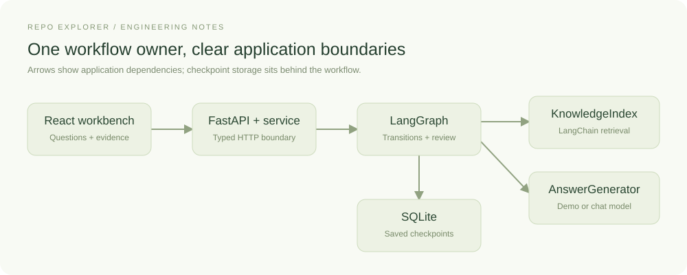

# Building Repo Explorer: the work of an AI engineer

Ask a model to explain a function, and the first question is what code it gets to
read. In one Repo Explorer experiment, retrieval found the beginning of
`publish_record`. The passage showed JSON serialization but stopped before the
file write. The model could explain that first operation and identify the missing
part. After the workflow added nearby lines, it could explain the write and the
replacement of the destination file too.

That small example gives us a concrete way to discuss AI engineering. The answer
depended on source selection, chunk boundaries, the model's input, and how the
application handled an incomplete explanation. Each of those was a software
design decision we could inspect and change.

This series follows those decisions through Repo Explorer, a local application
for asking questions about a configured repository and reading the source beside
the answer. It includes an optional React frontend, a Python API, a retrieval
pipeline, and a workflow that can save a brief for human review.


*The running workbench in offline demo mode. Questions execute retrieval and the
workflow; responses display extracted passages. Chapter five shows live model responses.*

## What the AI engineer is responsible for

Here, an AI engineer builds the application around a model: how it receives
information, what the program does with its response, and how we judge whether
the result helps someone. Repo Explorer uses existing models. Our work is in
connecting them to repository evidence and giving their output a useful place
in a developer's workflow.

Much of this work will look familiar to a software engineer. We define API
contracts, handle errors, keep credentials on the server, store application state,
and build an interface people can use. Model-generated answers add another
question: when a request completes successfully, is its explanation supported
by the information we supplied?

The project gives that question several practical forms:

| Engineering decision | Example in Repo Explorer |
| --- | --- |
| Choose the information available to the model | Index a selected directory and retain each passage's path, lines, and content revision. |
| Control the amount of context | Retrieve a limited set of passages and optionally add nearby lines within a budget. |
| Define the response contract | Require answer text, source identifiers, an answer-coverage assessment, and missing-information details. |
| Decide how execution proceeds | Stop for missing evidence, reject invalid source references, or pause for review. |
| Examine a failure | Compare the retrieved code, the generated explanation, and the source required to answer the question. |
| Support actual use | Preserve a run across reloads and show its original evidence after workspace settings change. |

The engineer still has to decide whether a feature earns its complexity. A second
retrieval step needs a question it can help answer. A diagram needs a relationship
that we can establish from evidence. A framework needs a responsibility that it
handles clearly.

## Why build this application?

For a function you already have open, asking a coding assistant to explain it is
a reasonable starting point. Repository search and IDE navigation are useful
baselines too. Building a separate application takes additional effort, so it
needs a specific purpose.

Repo Explorer lets us preserve the evidence behind a question, inspect the stages
that produced the answer, change retrieval settings, and compare the result.
A reader returning to a saved brief sees the same excerpts that reached the model.
That makes it useful as a small AI engineering study and a working investigation
tool we can evaluate.

Its practical advantage for everyday repository work remains an open question.
We still need comparisons on unfamiliar projects: can someone find the relevant
behavior faster, spot an unsupported explanation, or identify a missing
dependency more easily? The experiments in this series examine individual parts
of that problem. They leave the larger productivity claim open.

## Where RAG, LangChain, and LangGraph fit

RAG stands for **retrieval-augmented generation**. In this application, a question
first goes through a search over indexed repository passages. The selected text
is then included in the model request. The model uses that supplied context to
write an explanation with source references. This request-time use of external
information is the central idea described in [LangChain's retrieval guide](https://docs.langchain.com/oss/python/deepagents/retrieval).

An example makes the dependency clear. To explain how `publish_record` writes its
destination, the model needs the lines containing `pending.write_text(...)` and
`pending.replace(destination)`. The function name alone leaves those operations
unknown. Retrieving useful evidence becomes part of producing a useful answer.

**LangChain** supplies components we compose inside that pipeline: document
objects, embedding interfaces, a vector store, prompt templates, and chat-model
adapters. Our generation code connects a prompt to a model with a typed response:

```python
self.chain = prompt | model.with_structured_output(DraftAnswer)
```

The `|` passes the prompt's output into the configured model. `DraftAnswer`
describes the fields the application expects to receive. LangChain supplies the
composition and integration mechanisms; our code defines those fields, builds
the source input, and decides how to handle the result. The broader framework also
offers agent-building APIs; this project uses the components required by its
explicit workflow. See the [LangChain overview](https://docs.langchain.com/oss/python/langchain/overview)
for that broader scope.

**LangGraph** controls execution. Its state holds the question, evidence, answer,
qualifications, and completed steps. Nodes perform operations; edges choose the
next operation. A checkpoint preserves state, and an interrupt pauses a review
until a decision arrives. LangGraph supports this combination of deterministic
operations and model calls through its [orchestration runtime](https://docs.langchain.com/oss/python/langgraph/overview).

Repo Explorer currently searches once, optionally expands neighboring source,
and generates a response. Application rules control these steps. A model-directed
search loop would require further decisions about which tools it could call,
how much work it could do, and when it should stop. That remains future work.

## Put those responsibilities into code



The architecture keeps each responsibility in an identifiable place:

| Component | Responsibility |
| --- | --- |
| React workbench | Collect questions and display answers, sources, settings, and review controls. |
| FastAPI | Validate incoming requests and expose the backend's JSON HTTP API. |
| `RunService` | Create, read, and resume runs. |
| LangGraph workflow | Execute steps, apply branching rules, and pause for review. |
| `KnowledgeIndex` | Assemble the configured retrieval components and return source passages. |
| `AnswerGenerator` | Produce an extractive response or call a configured chat model. |
| SQLite checkpointer | Persist the workflow state used to restore a run. |

These components run inside a small local application. The backend starts
independently, and the bundled React workbench is one client of its API. A custom
frontend or command-line tool can submit the same questions and review decisions.
Retrieval, credentials, model calls, and workflow state remain in the backend.

Source loading, embeddings, generation, context expansion, and source analysis
have registered adapter contracts. Configuration selects an implementation. This
lets us compare lexical retrieval with learned embeddings while keeping the
question, generation code, and review behavior consistent.

The generation boundary has a small Python protocol:

```python
class AnswerGenerator(Protocol):
    def generate(self, question, intent, sources, policy) -> dict: ...
```

`ExtractiveGenerator` supports offline exploration by displaying source excerpts.
`ChatAnswerGenerator` sends those sources through the LangChain composition above.
Both feed the same workflow, with the demo explicitly marked as unassessed.

## Follow one request

Start in `backend/src/repo_explorer/api.py`. The API passes a new question to
`RunService.create` in `service.py`. The graph in `workflow.py` asks
`KnowledgeIndex` for evidence, optionally expands it, calls the generator, and
checks citation identifiers. A question can finish; a review brief can pause for
acceptance or rejection. That decision records the person's response to the brief.
Repository editing is outside the application's current scope.

The API returns the answer together with its passages and saved workflow state.
The React client in `frontend/src/api.ts` reads that response. A custom client
receives the same information; `docs/API.md` documents the contract.

This is a working local prototype with a focused containment map. Cross-file
relationship analysis, broader evaluation, and independent review remain unfinished. The following chapters
explain the implemented parts and the observations behind them, beginning with
how a source file becomes a retrieved passage.
