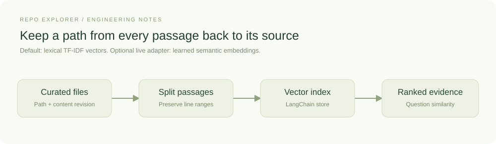

# From source files to useful evidence

Retrieval-augmented generation (RAG) supplies a model with information found for
the current question. In Repo Explorer, that information comes from code and
documentation in a configured directory. The quality of an explanation therefore
depends partly on which passages the search returns.

Consider a question about how a function writes a file. A passage containing its
name and serialization code may look relevant while omitting the actual write.
We need to inspect both the match and the missing lines. This chapter follows
how Repo Explorer selects that evidence and what happened when we changed the
retrieval method.

[LangChain's retrieval documentation](https://docs.langchain.com/oss/python/deepagents/retrieval)
describes document loaders, splitters, embeddings, vector stores, and retrievers as
separable components. Repo Explorer uses those building blocks directly. Its loader is
small project code because preserving repository paths and exact line ranges is a
specific requirement.

## Index the repository, then retrieve for a question

The work happens at two different times. During indexing, the source adapter reads
files, divides them into passages, and gives each passage a numerical representation.
The vector store holds those representations alongside the original text and its
source metadata. This prepares the collection for search.

At question time, the same representation method converts the question into a
vector. The store compares it with the stored passage vectors and returns the
closest matches, subject to the configured limit and score threshold. The backend
then supplies those passages to the generator. In live mode, they become context
in the model request; the model's weights stay unchanged. In demo mode, the
generator displays excerpts directly so the retrieval path can be explored offline.

An embedding is a vector of numbers used for these comparisons. A learned
embedding model can place related wording close together. Repo Explorer also
supports TF-IDF, which represents text using term weights. Both fit LangChain's
embedding interface, allowing us to compare their retrieval behavior through the
same store and workflow.

## Ingestion preserves the path back

The source adapter used by `KnowledgeIndex` walks a configured directory and admits supported text files.
It skips hidden paths, dependency directories, oversized files, and symlinks that
could escape the source boundary. An admitted Markdown file can still contain
sensitive information. The operator selects the corpus and decides which material
may reach the configured providers.

`RecursiveCharacterTextSplitter` creates overlapping passages. Each chunk carries
its text, a relative path, a start line, an end line, and a hash of the source file's
contents. The hash identifies a content revision. Git commit identities are
recorded separately by the snapshot-based evaluation tools.
Together those fields tell a reader exactly which local source was indexed.

Chunk boundaries affect usefulness. Very short passages lose explanations. Very
long passages can bury the relevant detail. The initial character-based settings
give us a baseline whose failures we can inspect. Syntax-aware splitting is a
possible extension when a real query demonstrates the need.

## Separate lexical similarity from semantic similarity

The offline mode computes TF-IDF vectors with scikit-learn through a LangChain
`Embeddings` adapter. TF-IDF gives distinctive terms more weight, and cosine
similarity ranks matching passages. It is useful for direct vocabulary such as
“checkpoint” and “ingestion”. A question using different words can miss relevant
code, as the examples below show.

Those vectors go into LangChain's `InMemoryVectorStore`. A live embedding adapter
can replace the lexical vectors without changing the graph. The score threshold
must then be reconsidered: the same numerical score can have different meaning
with a different embedding model. The score describes a match under that
representation; factual support requires examining the returned text.

## Names can hide the words in a question

A word-based retriever may treat `cache_lookup` and `cacheLookup` as unrelated
tokens. In a small authored example, asking for the “cache lookup implementations”
returns no passages with the default word tokenizer. The optional
`code_identifiers` setting separates naming components before lowercasing and
also retains a compact spelling. Both names contribute `cache`, `lookup`, and
`cachelookup`, so the same question retrieves the Python and TypeScript examples.

This uses the tokenizer extension of scikit-learn's
[`TfidfVectorizer`](https://scikit-learn.org/stable/modules/generated/sklearn.feature_extraction.text.TfidfVectorizer.html)
inside the existing LangChain embedding adapter. Source excerpts remain original;
only the representation used for ranking changes. The graph and HTTP API do not
need another retrieval implementation. Select the option in **Settings → Retrieval
→ TF-IDF tokenization**; the default remains `standard`.

The comparison is reproducible with `evaluations/identifiers.json` and
`examples/identifier-repository`. The evaluator runs standard TF-IDF,
identifier-aware TF-IDF, and keyword overlap on the same chunks and context budget.
The fixture was authored during development to illustrate the behavior, so its
results are limited to that example. The two functions are independent examples;
establishing a client/server connection would require a route or another explicit
link between them.

The failures matter too. The lexical methods still miss a paraphrase about
recovering remembered objects. Identifier tokenization also retrieves cache code
for a cloud-region question that the fixture cannot answer. Better matching can
increase distracting context. This is why retrieving a passage and establishing
that it answers the question must be evaluated separately.

## Try learned retrieval against an observed failure

The next experiment replaces TF-IDF with local learned vectors through the optional
FastEmbed adapter. It implements LangChain's embedding interface and delegates
inference to [FastEmbed](https://qdrant.github.io/fastembed/); the vector store and
LangGraph workflow stay the same. The model is a configuration choice. This run uses
`BAAI/bge-small-en-v1.5`, a small English text model, with local CPU inference after
downloading its weights. Its usefulness for code needs to be checked against the
questions and repositories we want to support.

The two methods receive identical chunks and return at most two passages. Context
expansion is disabled. The comparison also disables the similarity cutoff so that
a threshold tuned for TF-IDF does not become an unexplained threshold for learned
vectors. A TF-IDF query with no indexed vocabulary still produces no context.

For “How are remembered objects recovered?”, learned retrieval places the Python
cache implementation first, followed by an unrelated HTTP helper. The same Codex
generation pipeline now explains the dictionary lookup and the missing-key behavior.
It explicitly qualifies the interpretation: if “remembered objects” means cached
values, this implementation answers it. The model reports a partial answer because
the phrase itself is ambiguous. Retrieval improved without resolving user intent.

The direct-name control still locates both implementations. For the deployment-region
control, both methods return related cache code, and both generated responses say
the region cannot be determined. Learned similarity supplies evidence candidates;
it does not establish that the requested fact exists.

These are actual backend runs with the same generation configuration. The screenshots
elsewhere in this chapter remain offline interface demonstrations. The questions,
retrieved passages, model drafts, and source inspections are separate artifacts;
source support is assessed separately from citation validity and the model's own
answer-coverage label.

## Check whether the result transfers to real package code

A second comparison pins Cachetools v6.2.1 and indexes all five Python package files.
Questions and source annotations were written before inspecting either retriever's
results. This adds code not authored for Repo Explorer, although selecting a caching
library still limits the experiment's independence and domain coverage.

For `TTLCache.expire`, TF-IDF returns imports and decorator code, so generation
declines to explain the missing method. Learned retrieval returns the implementation;
the response explains the expiration cutoff and returned key/value pairs. The
[pinned source](https://github.com/tkem/cachetools/blob/ca7508fd56103a1b6d6f17c8e93e36c60b44ca25/src/cachetools/__init__.py#L491)
supports that explanation. Neither retriever recovers the full recency-eviction path
within the two-passage allowance. That investigation still needs additional evidence.

The concurrency question exposes a subtler issue. Learned retrieval finds the
[method-level condition wrapper](https://github.com/tkem/cachetools/blob/ca7508fd56103a1b6d6f17c8e93e36c60b44ca25/src/cachetools/_cachedmethod.py#L17),
and generation explains its pending-key set, waiting, and cleanup. Our annotation
instead names the analogous function wrapper. The returned code supports the
explanation, while strict evidence coverage reports the annotated span missing.
The question allows both interpretations; the reference needs that qualification.
Keep the original result and review the annotation instead of silently changing it
to reward one method.

These observations justify offering learned embeddings as a configurable option.
They also identify work that embedding choice alone cannot solve: retaining a
chunk's owning class, distinguishing related implementations, and following missing
operations across passages. Those are concrete requirements for later structural
context and evidence maps. The experiment does not establish a universal winner,
performance on large repositories, or an advantage over an IDE or coding assistant.

## Preserve definition identity without changing the retrieval experiment

The expiration example exposed an immediate gap: its passage contains the method,
but not its class header. Repo Explorer now offers a configurable `python_ast`
source analyzer. It uses Python's parser over the complete indexed text, then
attaches intersecting class and function definitions to each returned passage.
Embedding inputs, excerpt text, and ranking stay unchanged.

Select **Settings → Evidence context → Source analysis → python_ast**. The default
is `none`; the definition limit is also configurable. The analyzer is a separate
registered adapter, so another language can supply its own implementation without
changing the graph or frontend.

*Actual offline browser capture using an authored Python example. Code context
identifies the enclosing class and method while explicitly marking their definition
spans as partial. The source text remains the original retrieved fragment.*

A passage can cross several definitions, so the API returns a list of overlapping
definitions. Definition ranges refer to the
indexed file; full-span coverage means the entire definition is present in the
excerpt. Answer correctness needs a separate assessment.
The analyzer reports unsupported languages, parse failures, and mismatched source
explicitly. Nearby-line expansion recalculates the metadata because it can cross
definition boundaries. Saved reviews retain their original identities and evidence.

The Cachetools question was also exercised through real Codex generation with this
metadata. Its two retrieved excerpts were unchanged: the first identified
`TTLCache.expire` with full definition coverage, while the second identified a partial
`TLRUCache.expire`. The response still correctly explained the expiration operation.
This establishes that explicit identity reaches generation; the previous answer was
already correct, so the run does not demonstrate an answer-quality improvement.

The parser identifies definitions by their lexical scope in the file. Resolving
calls through inheritance, aliases, dynamic dispatch, or frontend/backend
contracts requires additional analysis. Chapter four shows how the interface uses
explicit containment relationships to group these definitions and open their
supporting passages. Other relationship types remain outside that view.

## Inspect a concrete query

Ask: **How does repository ingestion preserve source references?** The workflow
retrieves passages and the interface exposes their original text. Expand
`docs/ingestion.md` in the source explorer to inspect the source and line range.

*The offline generator displays the retrieved passage. The source card includes
its line range and content revision.*

The generator receives the retrieved passages. The mandatory `POLICY.md` file is
also loaded directly; policy enforcement must not depend on whether a similarity
search happens to return a rule. Some rules become deterministic graph behavior,
such as requiring a decision for review intent. Other rules remain prompt guidance
and should not be described as mechanically enforced.

## Missing evidence is a valid outcome

For a passage that matches but loses neighboring code at a chunk boundary, an
optional LangGraph context-expansion step can add nearby lines from the indexed
snapshot. It has explicit line and character bounds and preserves the original
ranking. The next chapter demonstrates that operation and its saved trace. It
does not fix a missing seed, follow a call to another file, or judge answerability.

When nothing exceeds the retrieval threshold, the graph routes to `abstain` and
does not call the generator. This prevents an empty context from becoming an
invitation to improvise. It does not solve weak but superficially similar matches;
retrieval relevance still needs inspection using real repository questions.

The index is rebuilt at startup or when settings are applied. Reapply settings
after editing the corpus. Completed and
pending runs keep their source excerpts in checkpoints, so later file edits do
not silently replace the evidence behind an earlier answer.
