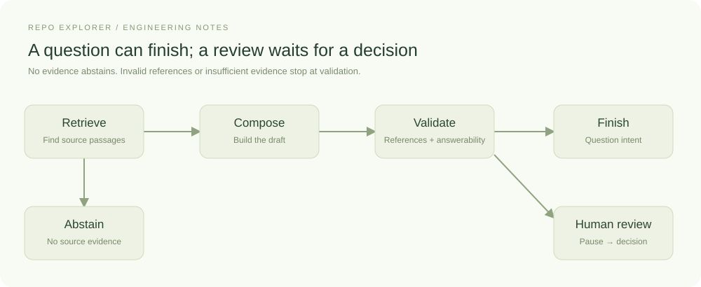
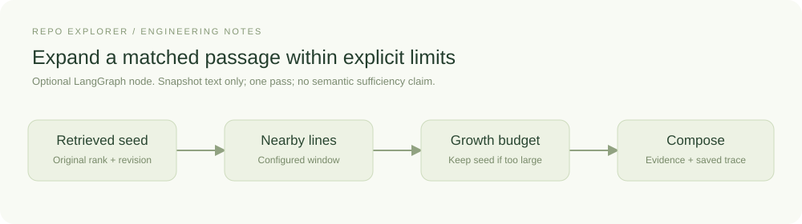
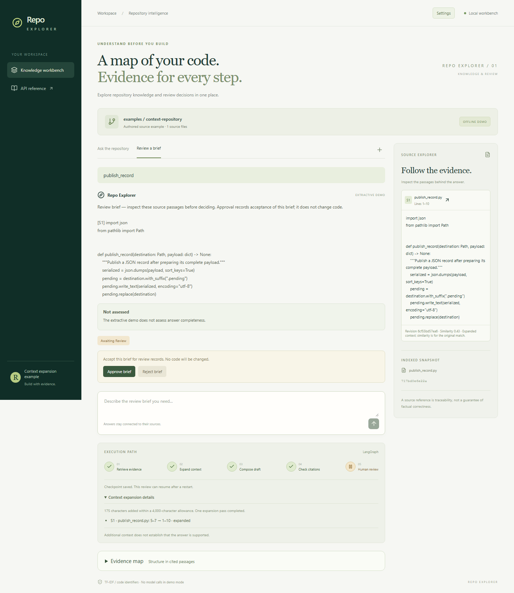
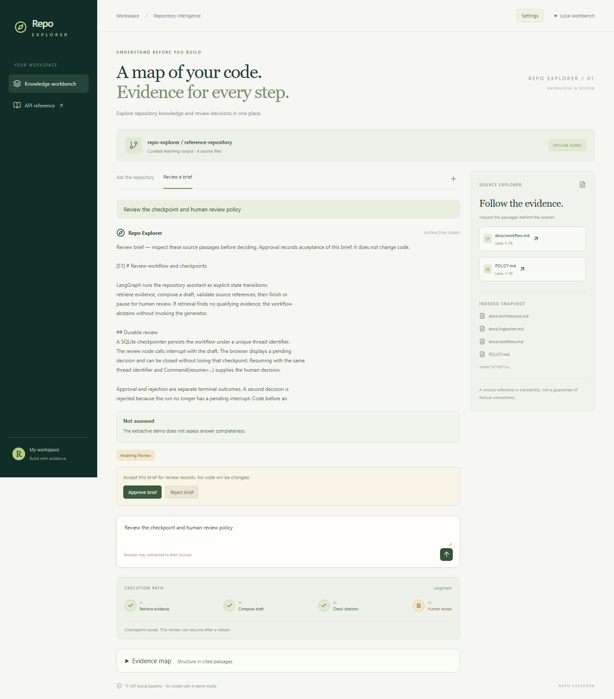

# A review that survives closing the browser

A review can last longer than an HTTP request. The person reading a draft might
close the browser, restart the application, or return tomorrow. A callback held in
memory cannot represent that lifecycle reliably. Repo Explorer uses a LangGraph interrupt
and a durable checkpoint to make the pending decision part of application state.

## Represent the workflow as state and steps

Orchestration is the code that decides what runs next and carries information
between steps. In LangGraph, a **state** is the data available to the workflow,
a **node** is a function that reads it and returns updates, and an **edge** connects
one step to the next. A conditional edge selects a path using the current state.
Those concepts are described in LangGraph's [graph API guide](https://docs.langchain.com/oss/python/langgraph/graph-api).

In Repo Explorer, retrieval adds source passages to the state. A conditional edge
checks whether any were found. It sends an empty result to abstention and sends
usable context toward generation. The rules are ordinary application code, so
we can inspect why a run took a particular path.



The default graph path is retrieve, compose, and validate. No evidence
routes directly to abstention. Invalid source references and model-reported
insufficient evidence stop the draft at validation. Complete or partial answers
with valid references finish for question intent, while review intent reaches an
interrupt. The extractive demo remains unassessed and follows the same review path.
The diagram omits helper functions and transport details so
the actual decisions remain readable.

In `backend/src/repo_explorer/workflow.py`, `RunState` stores the question, intent, evidence,
answer, citation identifiers, answerability, limitations, and completed steps.
Node functions return updates.
`build_workflow` connects them with `StateGraph` and compiles the graph using the
application’s SQLite checkpointer.

## Add context for a concrete retrieval failure

A matched passage can end just before the operation a reader needs to inspect.
In an authored example, retrieval finds `publish_record` at lines 5–7 while the
write and replacement operations are at lines 9–10. Merely reporting the function
name would leave the explanation without its supporting code.

Repo Explorer offers an optional `expand_context` node between retrieval and
composition. The earlier diagram shows the default with expansion disabled;
this focused diagram shows what the extra step does:



The conditional edge enters this node only when sources exist and an expansion
adapter is configured. A node need not call a model: LangGraph's
[graph API](https://docs.langchain.com/oss/python/langgraph/graph-api) represents
state updates and branching for deterministic operations too. Here the node
adds snapshot context, records its decisions, and then passes the evidence to
the existing generator. There is one pass and no loop.

Choose **Settings → Evidence context → line_window**. The default strategy is
still `none`. Users control surrounding lines and a shared added-character budget.
The expander uses text captured during indexing, verifies the original excerpt,
and preserves source identity. A candidate that does not fit the remaining budget
leaves the original passage intact. It never cuts a candidate midway through a
line merely to fit it.



*The authored source example runs in offline demo mode. The source now includes
the previously missing write/replace operations. The expanded trace records the
original and resulting ranges; similarity still refers to the original match.*

The public example is reproducible with `evaluations/context.json` and its
companion configuration. Its matched excerpt grows from 184 to 359 characters.
This spends additional context to recover nearby evidence. Because the context
sizes differ and the example was authored during development, the comparison
establishes only what that added window supplied. The API exposes the same trace
through `context_expansion`, so another frontend can explain the decision.

Increasing the original chunk size is another reasonable approach. In the private
development case, larger chunks also recovered the missing write sequence and
found a serialization rule that the fixed window missed. Expansion used less
context for the write question. These mixed results justify exposing configuration
and recording tradeoffs; they do not establish one universal chunking strategy.

The node applies the configured window whenever retrieval returns passages.
The expansion can still stop inside a function, and it stays within the retrieved
files. It also expands this function for an unanswerable question
about its production region. More source text cannot supply information absent
from the repository. Question-driven investigation and semantic sufficiency checks
remain separate work.

## Pause with data

The review node sends the draft to the caller:

```python
decision = interrupt({"kind": "review_brief", "answer": state["answer"]})
```

The node resumes when the application invokes the graph with a decision:

```python
graph.invoke(
    Command(resume={"approved": True}),
    {"configurable": {"thread_id": run_id}},
)
```

The identifier connects the request to the saved state. LangGraph's
[interrupt documentation](https://docs.langchain.com/oss/python/langgraph/interrupts)
explains this pause/resume contract and notes that the interrupted node starts
again on resume. Repo Explorer therefore performs no external writes before its interrupt.
A future node that creates a ticket or starts a worker would need an explicit
idempotency strategy.

## Follow the review in the browser

Select **Review a brief** and ask about the checkpoint and human-review policy.
The answer appears with an **awaiting review** status. The trace shows completed
retrieval, composition, and citation checks, followed by the paused review stage.



*The controls operate on a persisted interrupt. Approval records acceptance of
the review brief. This workflow has no code-execution step.*

Reload the page. Its URL contains the run identifier, and the browser fetches the
saved run from the API. Restarting the same application version also preserves
the pending review because the state is in SQLite. Approve or reject the brief to
reach a terminal status. The service refuses a second decision on a completed run.

When expansion was enabled, the enlarged excerpts and their trace are already
part of that checkpoint. Resuming review preserves them even if settings or the
source checkout changed afterward; it does not run context expansion again.
Approval also preserves the answer's qualifications: approving a partial brief
does not turn it into a complete answer. The model's assessment describes its
claimed coverage, while the review status records the person's decision.

## Know the persistence boundary

Persistence stores the state required to continue. Repo Explorer supports the
local restart case with a single backend process and serialized mutations.
Checkpoint migration across graph-schema changes, user authorization, and
distributed execution would need additional implementation. Source support also
needs its own review, regardless of whether the answer was saved successfully.

The API response includes the recorded node names. The frontend turns them into
a compact trace after the request completes. A running request currently waits
for its API response before those steps become visible in the browser.

See `service.py` for run identity and decision handling, and `workflow.py` for the
transitions. LangGraph's [persistence overview](https://docs.langchain.com/oss/python/langgraph/persistence)
provides the underlying checkpoint model.
