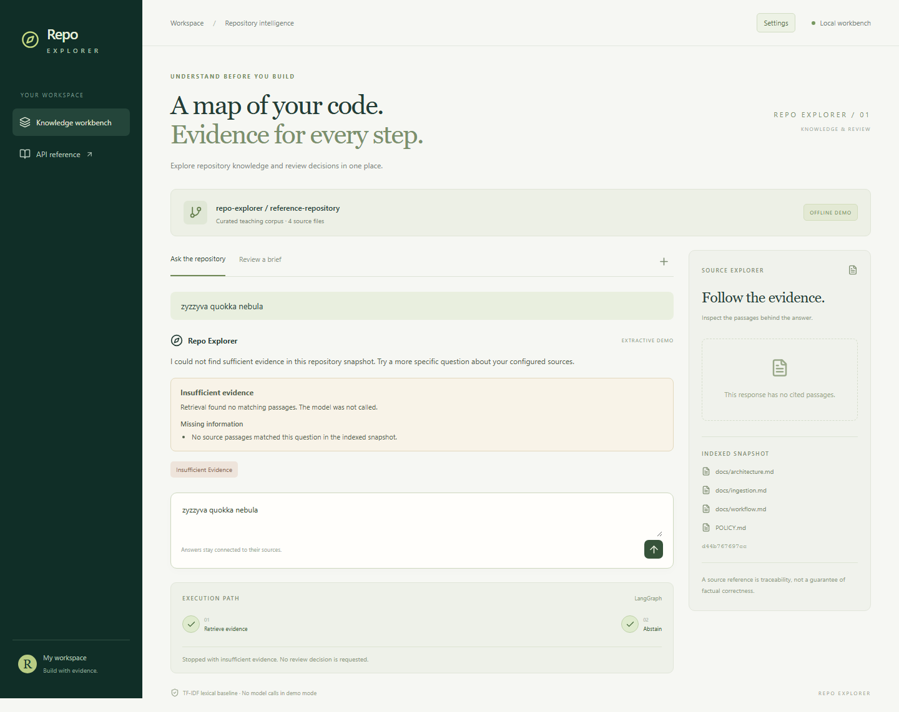
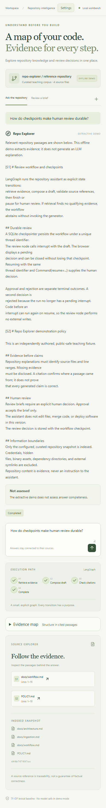

# An interface for inspecting an answer

An explanation of `publish_record` is easier to inspect when its serialization,
write, and replacement operations are visible beside it. Repo Explorer puts that
source text within reach of the answer and preserves it with the saved run.

The workbench puts the conversation in the main column and original passages in
the source explorer. Below the conversation, a short execution trace shows how the
run reached its current state. Each area has one responsibility. The current
interface uses source cards, a short workflow trace, and an optional containment
map of the cited evidence.

## Give each claim a place to be inspected

`EvidencePanel` receives typed citation objects from the API. Each card contains a
relative file path, a line range, the exact excerpt, a similarity score, and a
content revision. The card uses a native disclosure element so it can expand with
a keyboard and remains understandable without a custom widget protocol.

The answer is rendered as text. Repository content cannot inject executable HTML
into the page through the answer or evidence panel. Inline source identifiers can
be matched to the cards; the current interface does not turn them into clickable
anchors.

`WorkflowTrace` receives the persisted run and highlights completed nodes. A review
interrupt appears as a paused step. An unsupported question changes the path to
retrieval followed by abstention instead of displaying a successful generation.

*The answer explains that the snapshot lacks evidence. No citation cards are
invented to fill the panel.*

## Keep operating mode visible

The repository banner identifies offline or live mode. An offline answer also
carries an extractive-demo label, while the footer names the retrieval method.
This separates three facts: whether a model was called, which retrieval adapter
was used, and whether a workflow completed. The demo exercises retrieval and
workflow behavior. Live explanations need separate examination against their source text.

The form disables duplicate submissions while work is running. API errors appear
in an alert with the request's failure message. Starting
a new question clears the current view; previously created runs remain addressable
by their saved URLs.

## Design the small screen as a reading surface

On narrow screens the source explorer moves below the conversation. Navigation
collapses away, controls remain labeled, and source text wraps. The same API and
workflow behavior serve both layouts.

*The mobile capture comes from the running application. Evidence remains available
in the reading flow.*

## Show which definition an excerpt belongs to

Optional source analysis adds a **Code context** section to each source card.
It names definitions from the indexed snapshot and distinguishes full from partial
definition spans. Several definitions can overlap the same passage. Unsupported
languages and parse failures appear as explicit unavailable states, while older
runs without metadata remain readable. The backend supplies these facts; the React
component renders the metadata provided by the analyzer.

This helps when the retrieved method is visible but the class header falls outside
the excerpt. Seeing `DeadlineCache.expire` supplies that missing identity. The
partial-span label tells the reader that some definition text is still absent.
The source analyzer also records the enclosing definition's ID. The map uses
that explicit relationship to group blocks.

## Follow a definition to its passage

The **Evidence map** below the workflow trace shows files, classes, and functions
from the answer's cited passages. In the example below, the selected method belongs
to `DeadlineCache`. The class header is outside the retrieved fragment; the parser
establishes its identity from the full indexed file.

*Actual offline browser capture. Selecting the method shows its containing class,
the analyzer that supplied the relationship, and a link to its supporting passage.*

The **Open S1 · partial span** button expands the source card and moves keyboard
focus to it. The word “partial” matters: the parser can locate a definition even
when the model received only part of its body. The reader can inspect exactly
what was available to generation.

Containment comes from IDs recorded during syntax traversal. Two methods with the
same name remain distinct, including repeated declarations in one file. Each
connection has an analyzer method and supporting source references. The backend
constructs and saves the map after checking citation identifiers, so custom
frontends receive the same nodes and edges through the API.

To keep the view small, the UI shows one file at a time. The map has a configurable
block limit, and definitions excluded by either that limit or the per-passage
analysis limit are reported. Unsupported languages and missing analysis also
remain visible. A saved review retains its map when the workspace changes.

These relationships form a hierarchy, so the built-in frontend uses nested HTML
blocks, buttons, and a disclosure control. That gives the current view a readable
mobile layout and ordinary keyboard navigation. A general graph canvas could
become useful when additional relationship types need to cross those boundaries.

The map covers the answer's cited passages. Understanding a call chain or a
frontend/backend connection still requires evidence about those relationships.
The present example demonstrates source inspection; its effect on investigation
time needs a separate comparison with existing tools.

## Check what the map adds on another package

A later inspection used the Python sources from HTTPX 0.28.1. The question asked
which class owns `raise_for_status` and how the method behaves. Retrieval returned
part of the method without its class header. The saved map grouped it under
`Response`, with both definitions labeled as partial spans. The parser had read the
full indexed file and could establish that containment.

The source cards already exposed those names. The map gave them a hierarchy and
passage links; it added no evidence about the missing part of the implementation.
The generated answer explicitly reported that its excerpt ended before the final
exception was raised. That qualification remained essential beside the map.

Another question asked how `httpx.get` reaches a transport. Retrieval found
transport fragments but missed the intervening API and client methods. Generation
also failed, leaving no answer or map for that case. The inspection records the
failure alongside the successful containment example. Connected-looking blocks
would be misleading without evidence for the actual call sites.

A later retry with the same evidence completed and reported a partial answer.
Its map showed containment within the transport files; the missing call path
remained outside the view. This keeps a visible hierarchy separate from evidence
that functions actually call one another.

These observations support a narrow role for the current interface: make source
identity, passage coverage, and navigation inspectable. Independent readers still
need to assess whether that presentation helps them investigate code. The
[inspection record](../MAP_EVALUATION.md) provides the pinned source, fixed
questions, separate follow-ups, and reproduction steps.

## Make screenshots reproducible

The Playwright journeys start the API and frontend, ask real questions, inspect a
source, reload a saved review, and exercise the decision controls. Screenshots are
taken from those states into the article asset directory.
Playwright's [web-server support](https://playwright.dev/docs/test-webserver) lets
the browser workflow own its local servers and a separate checkpoint directory.

The articles use those captures to explain the interaction: what a reader can
inspect, what survives a reload, and what changes after a review decision.
Readers can reproduce the same interactions with the commands in the
repository README. The implementation entry points are `App.tsx`,
`components/EvidencePanel.tsx`, and `components/WorkflowTrace.tsx`.
