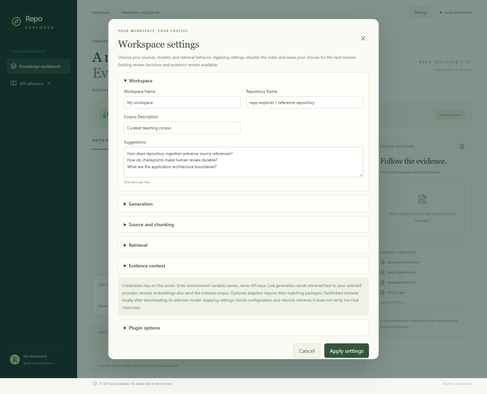
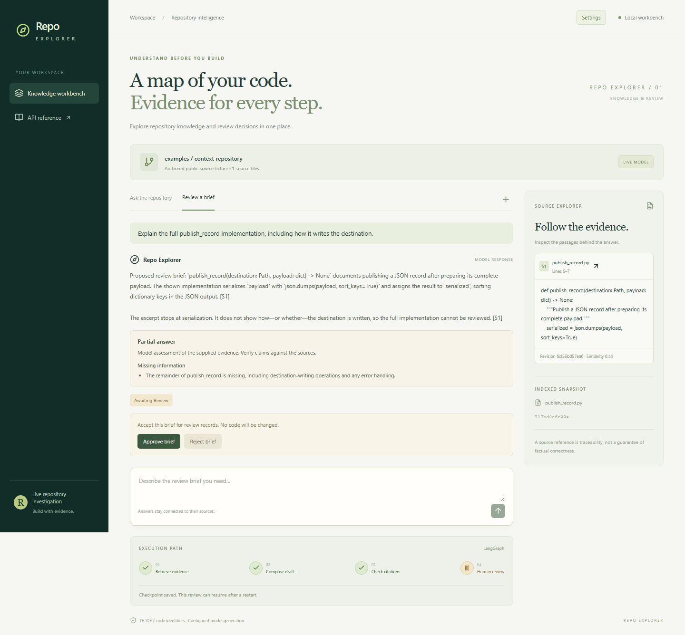
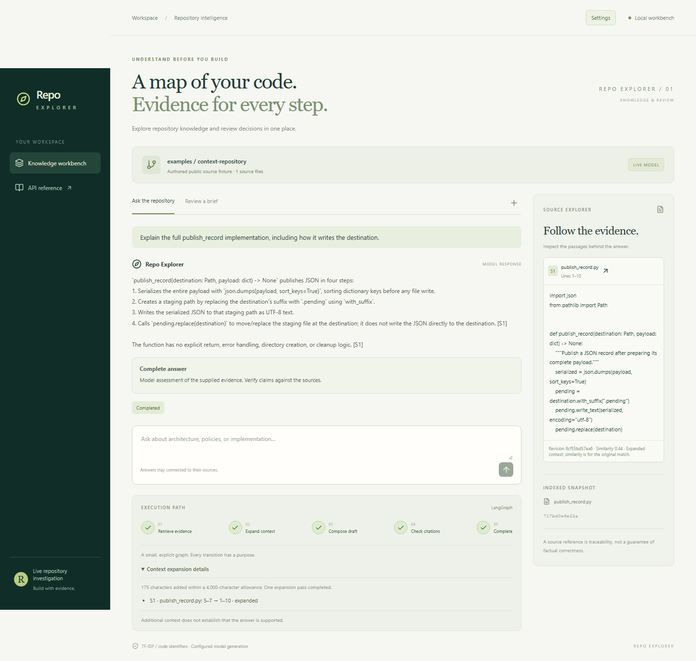
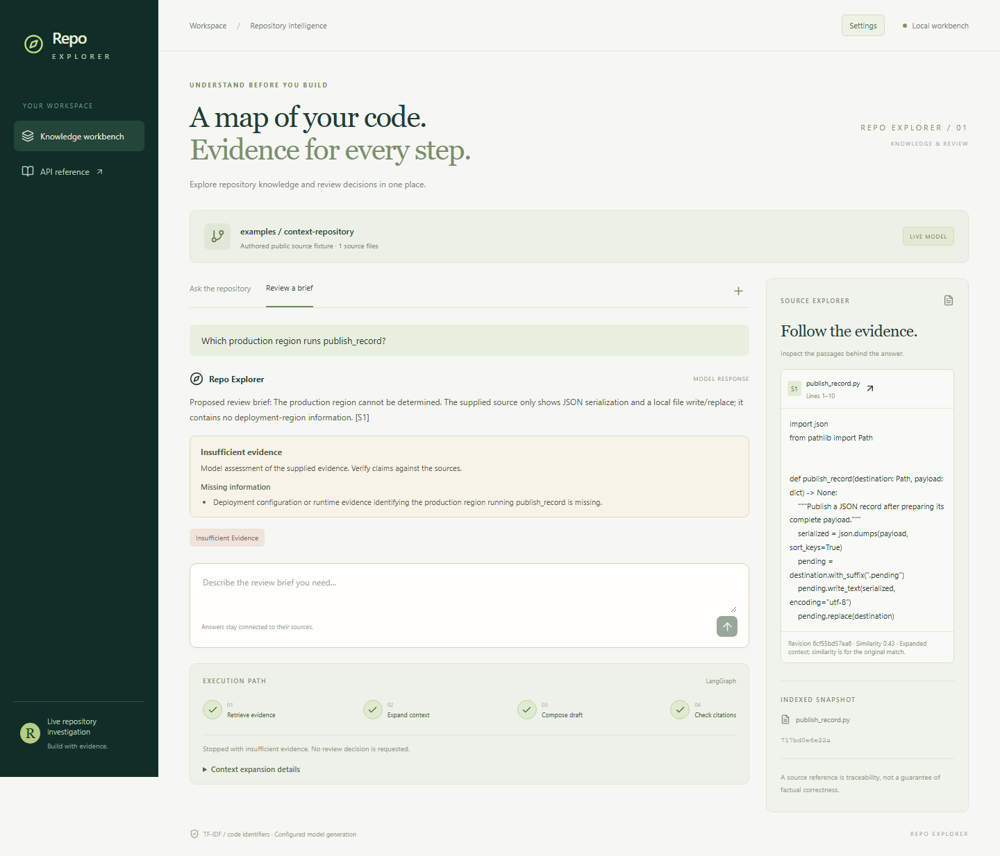

# Evaluating live answers against their sources

A model request can complete, return the expected fields, and cite a real passage
while still leaving the question partly answered. To understand that outcome, we
need to see which code reached the model and which claims the response makes.

This chapter follows live generation through Repo Explorer's LangChain adapter
and LangGraph workflow. It includes actual Codex-backed browser captures from the
public teaching fixtures, together with the evidence used to examine the answers.
The retrieval chapter records a separate local learned-embedding comparison.
Remote embeddings and other chat providers still need their own verification.

## Compose a prompt and a typed response

`ChatAnswerGenerator` builds a `ChatPromptTemplate` containing the mandatory policy,
the question, the intent, and retrieved source data. It composes that prompt with
the selected chat adapter's `with_structured_output(DraftAnswer)`. The result contains
answer text, the identifiers of the passages it cites, an `answerability` assessment,
and a list of `limitations`. Complete answers require an empty limitations list;
partial or insufficient-evidence responses must state what information is missing.

LangChain documents this adapter and its
[structured-output support](https://docs.langchain.com/oss/python/integrations/chat/openai).
OpenAI's [structured-output guide](https://developers.openai.com/api/docs/guides/structured-outputs)
describes schema-constrained responses. A valid schema gives the application a
reliable shape to parse. Whether the explanation follows from its sources is a
separate question that we examine below.

Repo Explorer checks that citation identifiers exist in the retrieved evidence and that
inline references agree with the structured list. This catches invented source
IDs and inconsistent citation metadata. It cannot catch every unsupported claim
that happens to point at a real source. The reader still needs the evidence panel.

## Configure the two independent choices

Open Settings to select the chat provider, model, and endpoint independently from
the embedding provider, model, and endpoint. Repository paths, chunk sizes, file
selection, retrieval limits, and workspace labels are also editable. Applying a
configuration prepares a replacement index and graph, persists `repo-explorer.json`, then
activates them. A failed update keeps the previous workspace usable; pending
reviews retain the evidence with which they were created.



*Workspace settings expose user choices while the graph retains citation and review rules.*

Alternatively, supply environment defaults before saving a workspace configuration.
From the project root, copy `.env.example` to `.env` and choose an available model:

```dotenv
REPO_EXPLORER_MODE=live
REPO_EXPLORER_MODEL=your-supported-model-id
```

Provide `OPENAI_API_KEY` in the server environment. Keep it out of the frontend,
repository commits, and screenshots. `REPO_EXPLORER_BASE_URL` is optional for a compatible
endpoint; the configured provider must support the adapter's structured-output
contract. Verify that contract with the selected provider before relying on it.

Generation and retrieval are separate choices. The default `tfidf` embedding provider
gives the live model passages retrieved by the existing lexical baseline.
Setting `REPO_EXPLORER_EMBEDDING_PROVIDER=openai` and an embedding model selects learned vectors through `OpenAIEmbeddings`.
This changes which passages are found without changing the graph's review logic.

Remote embedding configuration sends corpus text to the embedding provider.
Live generation sends retrieved text and policy to the chat provider. The bundled
teaching corpus is suitable for demonstrating that boundary. A private repository
needs a deliberate data-handling choice before being used as input.

## Use a signed-in Codex CLI locally

The `codex` chat adapter provides another integration route for a trusted local
workspace. Codex supports [non-interactive requests with saved authentication and a response schema](https://learn.chatgpt.com/docs/non-interactive-mode).
Repo Explorer wraps that interface in a LangChain chat model, so the existing prompt
and typed response still feed the same LangGraph workflow. Each invocation is a
separate request containing the configured policy, question, and retrieved evidence.

Each invocation receives the retrieved passages in a fresh turn. The adapter starts
in a temporary directory, disables project instructions, memories, browsing, plugins,
and shell tools, and requires a completed structured response. The model name and
reasoning effort are settings; the native executable path is configured by the
server operator. This preserves the separation between the optional React interface,
the backend workflow, and the replaceable generation provider.

Trying the integration exposed an operational failure before answer evaluation:
the installed CLI reported a ChatGPT sign-in, and retrieval found both annotated
cache implementations, but generation timed out. Windows used a local proxy while
the backend's CLI process lacked proxy environment settings. A direct connection
timed out; explicitly passing the existing proxy made the same pipeline complete.
Proxy routing is now an optional server setting, separate from model selection.

For the question “Find the cache lookup implementations,” the real response cited
the Python `LookupCache.cache_lookup` method's dictionary read and the TypeScript
`cacheLookup` function's HTTP request, error handling, and JSON response. Those
claims match the supplied passages, and the answer treats the two implementations
as independent examples. This small authored case demonstrates the integration
from retrieval through LangChain generation to LangGraph citation validation.
Performance on unfamiliar repositories remains to be evaluated.

Saved authentication, successful retrieval, a completed response, and a supported
explanation remain four separate observations. Citation validation checks source
identifiers; reviewing the actual claims still requires reading the cited evidence.

## Observe what changes when the evidence changes

The next live comparison kept the `publish_record` question, source snapshot, chat
model, and prompt fixed. With only lines 5–7 of the function, the model explained
JSON serialization and explicitly said that writing and error handling were not
visible. With bounded context expansion enabled, it received lines 1–10 and explained
the `.pending` file write followed by destination replacement. It also identified
the absence of explicit error handling or cleanup. Those statements match the
supplied source; neither response claimed crash-durability guarantees.

The extra context grew from 184 to 359 characters. This shows how including missing
logic can change an explanation, with a concrete context-size tradeoff. The example
was authored during development and each configuration produced one response, so
the result is limited to those observed responses.

Two controls expose the limits. The paraphrase “How are remembered objects
recovered?” still produced no lexical matches, so the graph abstained before calling
the model. A production-region question received the complete function but the
model still declined to name a region: the source supplied no deployment facts.

That earlier region response had valid citations, so the workflow marked it
`completed`. This revealed a contract gap: completion and valid references did not distinguish a
substantive answer from an explanation of why the question cannot be answered.
The current implementation addresses that gap with an explicit answerability
field and saved qualifications. Old reports retain their original outcomes;
old checkpoints without the field are shown as **Not assessed**.

These claim assessments were made by the Codex assistant reading the actual source
passages. Independent human review is still pending. The observed value here is the
ability to inspect which evidence reached generation and what changed with it.

## Follow answer coverage through the live interface

The subsequent browser walkthrough asks: “Explain the full `publish_record`
implementation, including how it writes the destination.” It uses the same authored
source, identifier-aware TF-IDF retrieval, and a configured Codex model. The first
request selects review intent with context expansion disabled.



*Live Codex generation with lines 5–7. The source contains serialization, while
the assessment names the missing destination-writing and error-handling information.*

The model explains the visible serialization and reports **Partial answer**. The
workflow independently reports **awaiting review**. Those labels answer different
questions: how much the response claims to explain, and whether someone has accepted
the brief. Reloading restores both. Approving this brief changes the workflow status
to `approved` while preserving its answer, partial assessment, and limitations.

Next, Settings enables `line_window` expansion. Asking the same question supplies
the complete function, including `pending.write_text(...)` and
`pending.replace(destination)`.



*The model reports complete coverage after receiving lines 1–10. The source and
expansion trace show exactly what additional evidence reached generation.*

The response describes serialization with sorted keys, a UTF-8 write to a `.pending`
path, and replacement of the destination. It also notes the absence of explicit
error handling or cleanup. Reading the displayed function supports those claims;
the label records the model's own assessment. Expansion made the missing operations
available. Each generated explanation still needs to be checked against its evidence.

Finally, the review question asks which production region runs this function.
Even the complete source contains no deployment configuration.



*The model identifies the missing deployment information. The workflow stops at
validation, and no approval action is offered.*

This response preserves its explanation and source citation with
`answerability=insufficient_evidence`. Reloading preserves the missing-information
message. A direct API attempt to approve it is also refused, so this behavior is a
backend rule available to every client of the API.

These captures come from an opt-in browser run with actual generation. The Codex
assistant inspected the recorded claims against the source; independent human
review remains pending. The browser run exercised the approval button to check
the saved decision and response fields. The README documents how to repeat the journey
with a locally selected provider and model.

## Observe behavior before adding sophistication

Try a question with a clear source passage. Inspect whether the model's explanation
is supported by it. Then try a paraphrase, an ambiguous question, and a question
outside the snapshot. Compare the retrieved passages before attributing a better
answer to the model. A poor context selection can look like a generation failure.

If retrieval finds nothing, Repo Explorer abstains before calling the model. If the provider
call fails, the API returns an error. If source identifiers are invalid, validation
prevents the draft from reaching the human-review gate. These are distinct outcomes
with different remedies.

## Separate retrieval failures from unsupported explanations

The project now includes an experiment runner around the same `KnowledgeIndex`,
`ChatAnswerGenerator`, and LangGraph workflow used by the API. A preflight checks
the hash-pinned source files and selected configuration without contacting a model.
An explicit execution records seed passages, optional context expansion, the parsed
model draft, and the final workflow answer. Reference annotations are withheld from
both retrieval and prompting.

LangGraph's [node-update stream](https://docs.langchain.com/oss/python/langgraph/streaming)
provides the observation boundary. It lets the evaluator preserve the composition
result before citation validation can replace it. The workflow still owns its
transitions, and evaluation observes the same pipeline used by the API.

Consider the public cache example from the retrieval article. The question “How are
remembered objects recovered?” defeats the lexical candidates. The later FastEmbed
comparison recovered the local mapping operation and the response explained it
with an explicit qualification about the ambiguous question. If the right operation
is present and the model describes
an unsupported deployment region, the failure is in the explanation. If the passage
never reaches the model, missing evidence is the first issue to investigate.

The runner creates a pending human-review record alongside its citation checks.
Reviewers identify material claims, mark their support against the supplied
context, and record missing qualifications. Reference notes help assess
completeness and may themselves need correction. Chapter two's ambiguous
concurrency question shows why annotations also need scrutiny.

The answerability contract also handles a refusal without citations. A response
explicitly classified as `insufficient_evidence` may omit references because it
makes no sourced explanation. Any references it does include must still match
known sources, including references inside its limitations. A complete or partial
answer requires valid citations. An unknown source identifier produces
`invalid_citations` regardless of the model's assessment.

The evaluator preserves both the draft and final workflow state. Its current
report distinguishes `model_abstention` from `no_context`: the former follows
generation using retrieved passages; the latter stops before generation. A
`partial` outcome records incomplete coverage, while `answered` records the model's
claim of complete coverage with valid citation structure. A reviewer separately
assesses factual support. Extractive or legacy generators without assessments are recorded
as `not_assessed`.

To compare retrieval methods, keep the same snapshot, questions, chat model,
policy, and context settings, then change the embedding configuration. Compare
evidence coverage before answer support and completeness. Record threshold changes
because scores from different embedding models are not interchangeable. Model
variation and the small authored corpus limit what a single comparison establishes.

Reports include elapsed timings and provider-reported chat token usage when the
adapter supplies it. Missing usage remains unknown; embedding costs and total
monetary cost are not measured. Source passages, parsed drafts, and final answers
are retained locally for review. The backend comparisons and the browser walkthrough
above provide different evidence: the former expose retrieval and generation
artifacts, while the latter exercise settings, displayed qualifications, saved
responses, and review actions through the real API.

## Let an external package expose an integration failure

A later check used pinned Python sources from HTTPX. Before running the pipeline,
we fixed questions about `raise_for_status`, the synchronous request path, and a
missing production region. Source inspection supplied a reference reading. The
pipeline then retrieved two passages per question through the same LangChain and
LangGraph components as the application.

The first answer identified `Response.raise_for_status`, but its excerpt stopped
before the final `HTTPStatusError` raise. The answer reported that limitation.
A separate follow-up enabled the existing line-window expansion and recovered the
missing operation. That run exposed another problem: the owning class disappeared
from the supplied metadata, and the model withheld it.

The cause was in our code. Expansion removed trailing blank lines while keeping
the original window's ending line number. Source analysis checked the excerpt
against that range, found a mismatch, and declined to attach definitions. The map
displayed a file and a source-mismatch issue. We corrected the range calculation
and added regression coverage for blank lines inside a file and at its end.

The corrected live run used the same question, configuration, and excerpt text.
It restored the definition metadata, identified `Response`, and explained the
method's return and error paths. The map marked the method's body as fully included
while keeping the larger class partial. That full-span label concerns the method
text; the definition of its `is_success` property was still outside the context.
The answer stayed at the supplied branch condition without claiming a status range.

The cross-file question exposed a different gap. Its retrieved passages described
transports but omitted the API and client methods that connect `httpx.get` to
them. The generation request also failed with an `invalid_response` error, so
that run produced no answer or map. The original failure stays in the record.
The deployment question completed in a separate run and identified the missing
application configuration without inventing a region.

We then made the generation diagnostics more specific and repeated the failed
question with exactly the same evidence. The repeat completed. Its answer
explained the transport fragments and explicitly identified the missing API/client
path. A successful second request cannot tell us why the first one failed. It does
let us inspect the retrieval problem independently of that execution failure.

Before adding another workflow step, we also checked the existing passage limit.
An offline comparison at two, four, and eight passages recovered the public API
delegations at the larger limit, but still missed the synchronous client's dispatch
path. Some additional results belonged to the asynchronous implementation.
That result gives a follow-up retrieval experiment a concrete target: find the
missing synchronous call sites while preserving evidence for each connection.

These outcomes direct work to different parts of the system: excerpt provenance,
connected evidence retrieval, and generation diagnostics. The
[HTTPX inspection record](../MAP_EVALUATION.md) includes source references,
configuration, separate follow-ups, and reproduction steps. These are assistant
observations; independent source review and a human navigation study remain open.

## Extend from a demonstrated need

Adapters are registered factories for source loading, embeddings, vector storage,
chat models, answer generation, context expansion, and source analysis. Installed packages can register additional names
through the `repo_explorer.plugins` Python entry-point group. The Settings screen
discovers those names from the backend. Each plugin can accept non-secret options;
credentials stay in server environment variables. A custom generator can change
prompt construction while preserving the graph's validation and review stages.
The repository's configuration guide describes the contracts and persistence rules.

The source-identity work in chapter two followed an observed problem: the returned
method omitted its class header. Python syntax metadata now supplies that identity.
The containment map in chapter four makes that identity inspectable alongside its
supporting passages. Recovering missing operations across files and resolving call
relationships remain open work. Further retrieval changes need similarly specific
examples before we add them.

That pattern has shaped the AI engineering work throughout this project. A missing
write operation led to bounded context expansion. A completed response that could
not answer the question led to explicit answer-coverage fields. An ambiguous
concurrency question exposed a problem with our reference annotation. Each
observation points to a different part of the system and a different correction.

The current result is a local application with an inspectable path from repository
text to a saved explanation. Broader evaluation, independent source review, and
comparison with ordinary repository search and assistant use are still needed.
Those results should guide how much further the application grows.
